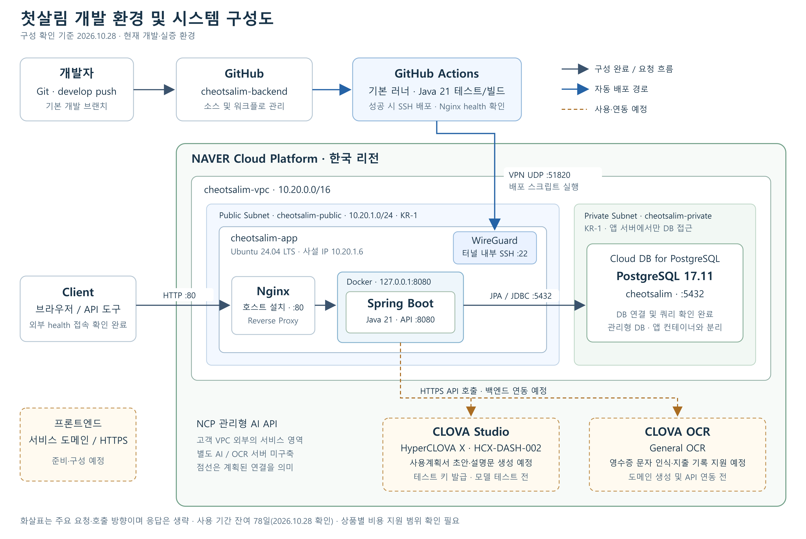

# 첫살림 개발 환경 및 시스템 구성

기준일: **2026년 10월 28일**

첫살림은 자립준비청년의 자립금 사용계획 수립과 지출 점검을 지원하는 웹 서비스이다. 민관협력 지원 플랫폼을 통해 네이버 클라우드 플랫폼을 이용하며, 현재 백엔드 실행, 관리형 PostgreSQL 연결, 외부 API 접근 및 develop 브랜치 기반 자동 배포를 확인했다. 기능 API와 프론트엔드 연동, AI·OCR 연동은 후속 개발 범위이다.

## 1. 시스템 구성도

[편집·확대용 SVG 원본](images/architecture.svg)

실선은 구성 완료된 자원과 확인한 연결, 파란 선은 자동 배포 경로, 점선은 사용·연동 예정 항목이다. 화살표는 주요 요청·호출 방향이며 응답 흐름은 생략했다. CLOVA API 영역은 고객 VPC 내부에 설치한 서버가 아니라 관리형 API 서비스의 논리적 영역이다.

### 서비스 요청 흐름

외부 클라이언트의 HTTP 요청은 앱 서버에 설치된 Nginx가 수신한다. Nginx는 요청을 서버 내부의 `127.0.0.1:8080`으로 전달하며, Docker 컨테이너의 Spring Boot 애플리케이션이 처리한다. 애플리케이션은 프라이빗 서브넷의 Cloud DB for PostgreSQL에 연결한다. 현재 `GET /api/health`의 DB 쿼리 및 외부 HTTP 200 응답을 확인한 상태이다.

Nginx와 WireGuard는 앱 서버 호스트에서 실행되며, 백엔드 애플리케이션은 Docker 컨테이너에서 실행된다. DB는 앱 서버 내부의 컨테이너가 아닌 별도의 관리형 DB 상품을 이용한다. 프론트엔드와 서비스 도메인, HTTPS는 아직 준비 중이므로 현재 구성도에서는 예정 항목으로 구분한다.

### 자동 배포 흐름

개발자가 기본 브랜치인 develop에 코드를 push하면 GitHub Actions의 기본 러너에서 배포 스크립트 검증, Java 테스트 및 JAR 빌드를 실행한다. CI가 성공하면 WireGuard VPN으로 앱 서버에 연결하고 터널 내부에서 SSH 배포 명령을 실행한다. 서버는 검증된 최신 develop 커밋을 반영하고 Docker 이미지를 빌드·실행한 뒤 컨테이너 및 Nginx 경유 health 응답을 확인한다.

배포용 VPN은 공인 IP의 UDP 51820을 사용하고, SSH는 터널 내부 TCP 22를 사용한다. 기존 공개 SSH의 관리자 IP 제한은 유지한다. 별도 self-hosted runner나 Docker Hub 이미지 저장소는 현재 배포 경로에 포함하지 않는다. main push와 PR에서는 CI만 실행한다.

## 2. 개발 스택

| 영역 | 기술·버전 | 역할 및 적용 상태 |
| --- | --- | --- |
| 언어 | Java 21 | 백엔드 애플리케이션 개발 및 실행 |
| 프레임워크 | Spring Boot 4.1.2 | 애플리케이션 구성 및 실행 기반 |
| 빌드 | Gradle Wrapper 9.8.2 | 의존성 관리, 테스트 및 실행 JAR 빌드 |
| 웹 API | Spring Web MVC | HTTP API 구현. 현재 health API 실행 확인 |
| 보안 | Spring Security | 현재 health GET만 공개하고 나머지 경로 차단. 사용자 인증·인가 기능은 후속 개발 |
| 데이터 접근 | Spring Data JPA, PostgreSQL JDBC Driver | PostgreSQL 연결 및 향후 엔티티 데이터 접근. `ddl-auto: validate`로 자동 스키마 변경 방지 |
| 입력 검증 | Spring Validation | 요청 데이터 검증용 의존성 포함. 기능 API에 적용 예정 |
| API 문서 | SpringDoc 3.2.0 | OpenAPI·Swagger UI 의존성 포함. 현재 외부 문서 노출은 비활성화 |
| 테스트 | JUnit Jupiter, Mockito, MockMvc | health 성공·실패 응답과 보안 동작 검증. 배포 스크립트는 별도 셸 검사 포함 |
| 실행 환경 | Ubuntu 24.04 LTS, Docker, Docker Compose | Linux 서버에서 컨테이너 기반 백엔드 실행 |
| 리버스 프록시 | Nginx | 외부 HTTP 요청을 내부 백엔드 포트로 전달 |
| CI/CD·형상 관리 | Git, GitHub, GitHub Actions | develop push 기반 테스트·빌드·자동 배포 |
| 배포 통신 | WireGuard, OpenSSH | GitHub 기본 러너와 앱 서버 사이의 VPN·SSH 배포 연결 |
| DB | PostgreSQL 17.11 | Cloud DB for PostgreSQL을 통한 데이터 저장 기반 |
| 생성형 AI, 예정 | CLOVA Studio / HyperCLOVA X `HCX-DASH-002` | 사용계획서 초안·설명문 생성 모델 테스트 및 API 연동 예정 |
| OCR, 예정 | CLOVA OCR / General OCR | 영수증 텍스트 인식 및 지출 기록 지원을 위한 도메인 생성·연동 예정 |
| 프론트엔드 | 미확정 | 저장소·개발 스택·서비스 도메인 준비 중 |

의존성이 포함된 것과 기능 구현이 완료된 것은 구분한다. 현재 확인된 범위는 인프라 연결 및 배포 기반이며, 사용자 인증, 사용계획서, 지출 기록 등의 업무 기능이 모두 구현되었다는 의미는 아니다. IDE와 Nginx·Docker의 상세 버전은 별도로 확인하지 않아 기재하지 않았다.

## 3. 민관협력 지원 플랫폼 활용 자원

| 구분 | 상품명 및 구성 | 활용 목적 | 현재 상태 |
| --- | --- | --- | --- |
| 클라우드 사업자 | Naver Cloud Platform, 한국 리전 | 서비스 개발·실증 및 운영 기반 | 민관협력 지원 플랫폼을 통한 이용 |
| 서버 | Server(VPC), Ubuntu 24.04 LTS, 2 vCPU, 메모리 4GB, 스토리지 30GB | 백엔드 애플리케이션 실행 | 구성 완료, 백엔드 및 자동 배포 실행 확인 |
| 데이터베이스 | Cloud DB for PostgreSQL(VPC), PostgreSQL 17.11, 2 vCPU, 메모리 4GB, 기본 스토리지 10GB·자동 증가 | 서비스 데이터 저장 및 관리 | 구성 완료, 서버 연결·쿼리 확인 |
| AI, 예정 | CLOVA Studio, HyperCLOVA X `HCX-DASH-002` 테스트 예정 | 사용계획서 초안 및 설명문 생성 | 테스트 API 키 발급 완료. 모델 테스트·기능 연동 전 |
| OCR, 예정 | CLOVA OCR, General OCR | 영수증 문자 인식 및 지출 기록 지원 | 일반 도메인 생성·API 연동 전 |
| 사용 기간 | 신청한 민간 클라우드 사용 기간 **78일 남음** | 개발 및 실증 | 2026년 10월 28일 확인 기준. 종료일은 신청 내역에서 별도 확인 |

AI와 OCR은 관리형 API 방식으로 이용할 계획이므로 별도의 AI·OCR 실행 서버 사양을 기재하지 않는다. 다만 API 호출 및 관련 서비스 이용에 따른 과금은 별개이며, **상품별 비용 지원 범위는 확인되지 않았다**. 자원 신청·키 발급만으로 모든 호출 비용이 지원된다고 판단하지 않는다.

## 4. 네트워크·운영 구성

| 항목 | 현재 구성 |
| --- | --- |
| VPC | `cheotsalim-vpc`, `10.20.0.0/16`, Normal 유형 |
| 앱 서버 서브넷 | `cheotsalim-public`, `10.20.1.0/24`, KR-1 |
| DB 서브넷 | `cheotsalim-private`, KR-1. CIDR은 제공된 정보에 없어 생략 |
| 앱 서버 | `cheotsalim-app`, 사설 IP `10.20.1.6`, 공인 IP 할당 |
| DB | `cheotsalim-db` / `cheotsalim-db-service`, DB명 `cheotsalim`, TCP 5432 |
| DB 접근 | DB 사용자 접속 범위 `10.20.1.6/32` 및 DB ACG의 앱 서버 접근 허용 |
| 백엔드 노출 | Compose 호스트 포트 `127.0.0.1:8080`, 외부 요청은 Nginx 경유 |
| Nginx | IPv4 HTTP 80 사용. 서버의 IPv6 소켓 제한에 맞춰 구성 |
| 배포 연결 | WireGuard UDP 51820, 터널 내부 SSH 22. 별도 배포 러너 서버 없음 |
| 비밀정보 | 서버 `.env` 및 GitHub Environment secrets 사용. Git·Docker 빌드 컨텍스트에서 비밀 파일 제외 |
| DB 백업·가용성 | 백업 사용, 보관 1일. 고가용성 미사용 |
| 보호 조치 상태 | 서비스 HTTPS 및 DB 스토리지 암호화 미적용. 실제 개인정보 사용 전 보호 방안 확인 필요 |

현재 단일 앱 서버를 사용하며 재배포 중 짧은 중단이 발생할 수 있다. 자동 rollback은 포함하지 않는다. 배포용 WireGuard 암호화는 사용자 웹 접속의 HTTPS나 DB 저장소 암호화를 대신하지 않는다.

## 5. 보고서에 사용할 설명문

첫살림은 민관협력 지원 플랫폼을 통해 네이버 클라우드 플랫폼의 VPC 기반 서버와 관리형 PostgreSQL을 활용하여 개발 환경을 구축하였다. Ubuntu 24.04 LTS 서버에서 Docker 기반 Spring Boot 백엔드를 실행하고, Nginx를 통해 외부 요청을 전달한다. 데이터베이스는 프라이빗 서브넷에 배치하여 앱 서버에서 접근하도록 구성하였다. 또한 GitHub Actions와 WireGuard·SSH를 연계하여 develop 브랜치 push 시 테스트·빌드 후 자동 배포하는 흐름을 구축하였다.

향후 CLOVA Studio의 HyperCLOVA X 모델을 활용하여 사용계획서 초안 및 설명문 생성을 테스트하고, General OCR을 연계하여 영수증 문자 인식과 지출 기록을 지원할 계획이다. 현재 AI 테스트 API 키는 발급되었으나 모델 테스트와 OCR 도메인 생성 및 기능 연동은 완료되지 않았다. 상품별 비용 지원 범위는 별도 확인할 예정이다.

## 6. 확인 근거

- 버전·의존성: 저장소의 `build.gradle`, Gradle Wrapper 및 Spring 설정.
- 배포·통신: 저장소의 Compose, Nginx, GitHub Actions 및 WireGuard 설정과 사용자 확인 결과.
- 클라우드 사양·지원 기간·AI/OCR 준비 상태: 사용자 제공 정보. 클라우드 계정의 실제 과금·지원 내역을 별도로 조회한 것은 아님.
- [CLOVA Studio 모델 공식 문서](https://guide.ncloud-docs.com/docs/clovastudio-model): 모델 구분 참고.
- [General OCR 공식 문서](https://guide.ncloud-docs.com/docs/clovaocr-general): 일반 도메인 생성·API Gateway 연동·API 호출 절차 참고. 향후 OCR 연동 시 관련 자원과 비용 지원 여부도 확인 필요.
